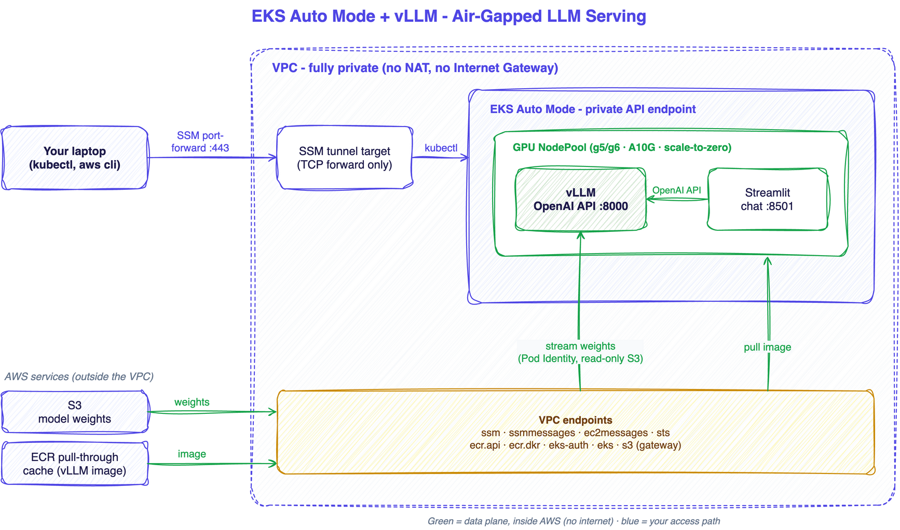

# Design

This document explains why the stack looks the way it does. [README.md](./README.md) covers how to run it, what it costs and how to tear it down. The [Model Hosting Primer](docs/model-hosting-primer.md) explains the model-serving terms used here.



## What we were aiming for

The goal was to learn how to host a model on EKS properly, in a cluster that is cheap enough to create and destroy on demand. "Properly" meant three things: no public Kubernetes API, no internet access from the data plane, and the smallest IAM permissions that work. "Cheap" meant one GPU, one replica, and a teardown that leaves nothing behind.

Those goals decided most of what follows. The short version:

- **One A10G GPU and an ~8B model at 16-bit precision.** It is the smallest setup that serves a genuinely useful model without quantizing it.
- **Qwen2.5-7B-Instruct as the default model,** because it needs no Hugging Face token.
- **Weights in S3, streamed straight into GPU memory,** because the cluster can't reach Hugging Face.
- **The vLLM image through an ECR pull-through cache,** because the cluster can't reach Docker Hub.
- **A private API reached through an SSM tunnel,** because there is no public endpoint to connect to.
- **OpenTofu or Terraform for AWS, plain manifests for Kubernetes,** applied in two separate steps.
- **`ca-central-1`, two Availability Zones.**

## Why Qwen and not Llama

Llama-3.1-8B is the obvious choice, but it is gated: you have to accept a license on Hugging Face and use a token. Qwen2.5-7B-Instruct is Apache-2.0 licensed and fits on the same GPU, so the first run works with no token at all. The staging script takes the model ID as a parameter, so switching to Llama is a one-line change. The README shows how.

## Getting the model in

The weights are about 15 GB, and the cluster has no route to Hugging Face. We could have opened a route for a download job. Instead, the download happens once, on your laptop (`scripts/stage-model.sh`), and the files go to an S3 bucket in the same account. That keeps the data plane fully offline and moves the slow download out of the cluster's lifecycle: destroying and recreating the cluster doesn't download the model again.

At startup, vLLM loads the model with `--model s3://<bucket>/<model>/ --load-format runai_streamer`. The Run:ai streamer reads the safetensors files from S3 over many parallel connections and writes them straight into GPU memory. There is no init container and no copy on local disk, and a restarted pod streams from S3 again instead of downloading anything. The bytes travel over the S3 gateway endpoint, so they never leave AWS.

The pod's service account, `model-storage-sa`, is linked to an IAM role through EKS Pod Identity. That role can list and read one bucket and nothing else. The streamer finds the credentials through the normal AWS SDK chain, so no keys are passed to vLLM. Auto Mode already runs the Pod Identity agent, so there is nothing to install.

One side effect: `HF_HUB_OFFLINE` must not be set. It looks like the right flag for an offline cluster, but in vLLM 0.22.0 it makes startup reject the `s3://` path. The README's troubleshooting section tells the full story.

## Getting the image in

The nodes can't pull from Docker Hub either. AWS publishes its own build of vLLM (a Deep Learning Container) on ECR Public, which needs no login. An ECR pull-through cache rule points at ECR Public, so the cluster pulls `<account>.dkr.ecr.<region>.amazonaws.com/ecr-public/deep-learning-containers/vllm:<tag>`. When the cache doesn't have the image yet, ECR fetches it from its own side, not through the VPC.

`make prewarm` does the first pull from your laptop. That creates the cache repository and fills it, so the nodes only ever read cached images and their IAM role can stay at pull-only. It also sidesteps some first-pull edge cases.

## Getting yourself in

The API endpoint is private, so the API only accepts connections from inside the VPC. SSM can forward a port, but only through an instance running the SSM agent. So there is one `t3.small` in a private subnet with no public IP, no SSH key, nothing installed and no cluster permissions. Its instance profile has only `AmazonSSMManagedInstanceCore`. It is a relay, not a bastion: `kubectl` still runs on your laptop, and you authenticate as your own AWS identity, which got cluster-admin when the cluster was created.

The API's certificate is issued for its real hostname, not `localhost`, so the tunnel script sets `tls-server-name` in the kubeconfig. `kubectl` connects to the local end of the tunnel but checks the certificate against the right name. AWS CloudShell can also run inside a VPC, which is handy for a one-off command but isn't scripted here.

## The network

The VPC has private subnets in two Availability Zones and no NAT gateway or internet gateway. Everything the cluster needs from AWS comes through VPC endpoints:

- **Interface endpoints:** `ssm`, `ssmmessages` and `ec2messages` for the tunnel; `ecr.api` and `ecr.dkr` for images; `sts`, `eks` and `eks-auth`. Pod Identity can't work privately without `eks-auth`.
- **The S3 gateway endpoint,** which carries both the model weights and the ECR image layers (ECR stores layers in S3).

DNS hostnames and DNS support are switched on, because the private API endpoint depends on an EKS-managed private hosted zone. The subnets carry the `kubernetes.io/role/internal-elb=1` tag in case Auto Mode needs to place an internal load balancer, though this stack doesn't create one.

## The cluster

The cluster uses the `terraform-aws-modules/eks` module (v21) with Auto Mode switched on and its built-in `general-purpose` and `system` node pools. Auto Mode is the main reason this project is small. AWS runs Karpenter, the NVIDIA driver and device plugin, the EBS driver, CoreDNS and the Pod Identity agent, so none of them are installed or upgraded by hand. Access uses EKS access entries, the module's default, rather than the old `aws-auth` ConfigMap. The only entry is the identity that ran `apply`.

The GPU NodePool uses the Auto Mode API group (`karpenter.sh/v1`) and the built-in `default` NodeClass. It allows on-demand `g5` and `g6` instances on amd64. `g6` is there as a fallback, because its capacity in `ca-central-1` is thinner than `g5`'s; the order of the list is not a preference, and Karpenter picks whichever fits. The node carries a `nvidia.com/gpu:NoSchedule` taint, so only pods that tolerate it land there. The pool is capped at one GPU, which stops a mistake from launching a second one. That cap is also why a rollout's new pod waits in `Pending` until the old one frees the node.

## The vLLM pod

vLLM runs as an ordinary Deployment with one replica, behind a ClusterIP Service on port 8000. The main arguments are:

```
--model s3://$BUCKET/$MODEL_ID/ --load-format runai_streamer
--served-model-name chat
--max-model-len 8192 --gpu-memory-utilization 0.90
--tensor-parallel-size 1
```

`--served-model-name chat` gives clients a stable name, so switching models doesn't change the client code. The context length and memory fraction are sized so that the 16-bit weights plus the KV cache fit in the A10G's 24 GB.

The pod mounts a memory-backed `emptyDir` at `/dev/shm` with an 8 GiB limit. PyTorch uses shared memory to pass data between processes, and a container's default of about 64 MiB can run out. It matters most when one model is split across several GPUs, which this setup doesn't do. But vLLM's own Kubernetes examples include it even for one GPU, and since the limit is a cap rather than a reservation, it costs nothing until it is used.

A startup probe on `/health` allows plenty of time for the weights to stream in. Readiness and liveness probes take over once it succeeds.

The Service is named `llm-api`, not `vllm`. Kubernetes would otherwise inject a `VLLM_PORT` variable that vLLM misreads as its own setting. The README explains the crash.

The container runs as root. AWS's vLLM image writes caches and compiles kernels in places a non-root user can't write to. A production deployment would fix that properly; this one doesn't.

## The chat app

Streamlit is there to prove the deployment works end to end. `app.py` uses the standard `openai` Python client pointed at `http://llm-api:8000/v1`, because vLLM speaks the same API. The image is built on your laptop and pushed to a private ECR repository that Terraform creates. You reach it with `kubectl port-forward` through the tunnel.

## Two layers, applied separately

Terraform only uses the AWS provider. It has no Kubernetes or Helm provider, so it can run from anywhere. The Kubernetes manifests are applied from your laptop through the tunnel, because that is the only way to reach the API. Keeping the layers apart also keeps `destroy` reliable: Terraform never needs a working connection to a cluster it is in the middle of deleting.

## Accelerator choice: NVIDIA GPU vs AWS Neuron

The biggest choice in hosting a model on EKS is which chip it runs on. We chose an NVIDIA GPU. This section records why, so the choice can be revisited.

**The difference.** An NVIDIA GPU (A10G in `g5`, L4 in `g6`) runs a model as it is: hand vLLM the safetensors files and it serves them, because every framework targets NVIDIA's CUDA first. AWS Neuron chips (Inferentia2 in `inf2`, Trainium in `trn1`) are AWS's own and cost less, but a model has to be compiled for them ahead of time into Neuron's format (NEFF). It is like building a binary for a specific CPU instead of running a script. That one requirement drives every other difference.

**What Neuron would change:**

- **Cost:** roughly 30-40% cheaper for the same inference work.
- **Getting a model running:** you need a precompiled version, or you compile it yourself, which takes about 15 minutes, the Neuron toolchain and internet access.
- **Model choice:** only compiled models run. AWS publishes a short list (Mistral-7B and a few Qwen3 models). Our default, Qwen2.5-7B, isn't on it.
- **Loading from S3:** Neuron uses a different loader that only reads local paths, so streaming from `s3://` wouldn't work. An init container would have to copy the files from S3 first.
- **Staying offline:** still possible, but you have to stage the safetensors *and* matching compiled artifacts. If an artifact is missing or doesn't match, the loader falls back to downloading and compiling, which needs the internet.
- **Auto Mode:** no difference. It installs the Neuron driver and device plugin too, though you still need a Neuron NodePool.
- **Skills:** the GPU path is what most of the industry uses. Neuron knowledge is AWS-specific.

**Why GPU here.** This project is for learning, and the cluster runs on demand rather than all the time. Neuron's advantage is price, and that pays off over months of steady production use. Its costs (compiling ahead of time, a narrow choice of models, AWS-only tooling) have to be paid before anything runs. For a cluster that lives for an afternoon, the GPU wins.

**If we switch later,** for a long-running deployment of a model Neuron supports:

- A Neuron NodePool for `inf2` or `trn1`, with an `aws.amazon.com/neuron` taint, and pods requesting `aws.amazon.com/neuron: 1`.
- The Neuron vLLM image, `public.ecr.aws/neuron/pytorch-inference-vllm-neuronx`, through the same pull-through cache.
- A precompiled model, such as one from AWS's `aws-neuron` Hugging Face organization or one we compile ourselves, staged to S3.
- An init container that runs `aws s3 sync` into a local path.
- `vllm serve /models --device neuron --tensor-parallel-size <cores>`, with `NEURON_COMPILED_ARTIFACTS` set.
- A separate service quota and separate regional availability for `inf2` and `trn1`.

## How this compares with the AWS EKS Workshop

The [EKS Workshop chatbot module](https://www.eksworkshop.com/docs/aiml/chatbot/) serves a model with vLLM too, so it was a useful check. Most differences follow from two choices. The workshop doesn't use Auto Mode, so it installs Karpenter and the load balancer controller itself. And it runs on Neuron, so it downloads precompiled models from Hugging Face in an init container into an `emptyDir`, downloading again on every pod restart. This project stages the weights in its own S3 bucket instead, which survives restarts and needs no internet from the cluster. That is the S3 streaming approach AWS documents in the EKS user guide. AWS doesn't provide a bucket of weights or require Hugging Face. Its `aws-neuron` organization on Hugging Face only matters for Neuron chips.
