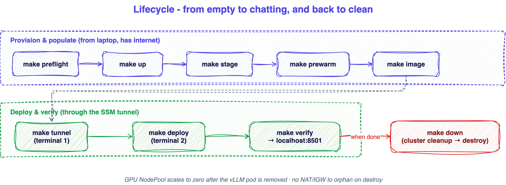

# EKS Auto Mode + vLLM - private LLM serving

This repo runs an open ~8B model (Qwen2.5-7B-Instruct) on one GPU in Amazon EKS Auto Mode, inside a cluster that cannot reach the internet. vLLM serves an OpenAI-compatible API, and a small Streamlit chat app lets you check that it works.

It is a reference implementation, not a production deployment. There is one replica on one GPU, no high availability or disaster recovery, and the serving container runs as root. It is meant to be read, run and adapted. The whole stack comes up from an empty AWS account and goes away with one command, so you only pay while you are using it.

> **New to model hosting?** If you know Kubernetes but terms like *weights*, *safetensors*, *CUDA* or *KV cache* are fuzzy, read the [Model Hosting Primer](./docs/model-hosting-primer.md) first. [`DESIGN.md`](./DESIGN.md) explains why each choice was made.


## The three problems

The cluster has no NAT gateway and no internet gateway. It reaches AWS only through VPC endpoints, and its Kubernetes API has no public endpoint. That is the point of the project, and it creates three problems. Everything in this repo answers one of them.

**Getting the model in.** The weights are about 15 GB, and the cluster cannot download them from Hugging Face. So you download them once on your laptop and copy them to S3 (`make stage`). When the pod starts, vLLM's Run:ai streamer reads them from S3 straight into GPU memory over the S3 gateway endpoint. Nothing is copied to disk and the bytes never leave AWS. The pod gets read-only access to that one bucket through EKS Pod Identity, so no keys are involved.

**Getting the image in.** The nodes cannot pull from Docker Hub. Instead, ECR has a pull-through cache pointed at ECR Public, where AWS publishes a vLLM image that needs no login. When the cache misses, ECR fetches the image itself from AWS's side, so the nodes still never touch the internet. `make prewarm` does that first pull from your laptop, which means the nodes only ever read from the cache.

**Getting yourself in.** With a private API, `kubectl` on your laptop has nothing to connect to. A tiny EC2 instance in the VPC acts as an SSM relay. It has nothing installed and no cluster permissions; it only forwards TCP. `make tunnel` forwards `localhost:8443` to the API through it, and you authenticate as your own AWS identity.

Auto Mode takes care of the rest. It manages Karpenter, the NVIDIA driver and device plugin, the Pod Identity agent and CoreDNS, so none of them are installed by hand. The GPU NodePool allows a single A10G (`g5.xlarge`, falling back to `g6`), is tainted so only the model lands on it, and scales to zero when nothing needs it. [`DESIGN.md`](./DESIGN.md#accelerator-choice-nvidia-gpu-vs-aws-neuron) explains why this uses an NVIDIA GPU rather than AWS Neuron.


## Before you start

You need:

- OpenTofu (`brew install opentofu`) or Terraform. The Makefile uses whichever it finds.
- The AWS CLI, logged in to the account you want to use.
- `session-manager-plugin`, for the tunnel.
- `kubectl` and `docker`, with the `buildx` plugin. With Homebrew: `brew install docker-buildx`, then add `"cliPluginsExtraDirs": ["/opt/homebrew/lib/docker/cli-plugins"]` to `~/.docker/config.json`.
- `helm` (`brew install helm`). The v2 branch installs the NVIDIA DRA driver with it.
- Optional: `crane` (`brew install crane`) or `skopeo`, only for `scripts/mirror-image.sh`.
- GPU quota in `ca-central-1`: at least 4 vCPUs of "Running On-Demand G and VT instances".

The quota is the usual blocker. New accounts often start at 0, and an increase can take about a day. `make preflight` checks it and prints the request command if it is too low.

## v2 in progress

This branch, `v2`, is changing the stack: two models sharing one GPU through a managed node group, weights shipped as images, and an inference-aware gateway. The [`v1` tag](../../tree/v1) on `main` is the stack this README describes. Until v2 is finished, the steps above still apply; the v2 work runs on a separate spike stack:

- [`docs/v2-plan.md`](./docs/v2-plan.md): the plan, with a status section at the top saying where it stands and how to resume.
- [`spikes/README.md`](./spikes/README.md): the runbook. It covers the free local checks on kind (`make test`, `spikes/local/up.sh`, needs Colima or Docker Desktop), `make weights` to download the models the day before, and the cloud spike in one sitting.
- [`docs/lab-log.md`](./docs/lab-log.md): what was run, what broke, timings and cost.

Add `SPIKE=1` to any `make` target to work on the spike stack instead of this one. It has its own Terraform workspace, project name and kubeconfig, so the two can exist side by side.

## Run it



```bash
make preflight          # credentials, tools, GPU quota
make up                 # VPC, EKS, endpoints, tunnel instance (~15-20 min)
make stage              # download the weights and copy them to S3 (one time, ~15 GB)
make prewarm            # pull the vLLM image into the ECR cache
make image              # build and push the Streamlit image

# Terminal 1 - leave this running
make tunnel

# Terminal 2
export KUBECONFIG=$PWD/kubeconfig
make deploy             # GPU NodePool, vLLM, Streamlit
kubectl -n llm get pods -w   # vLLM is Ready after the GPU node starts (~2 min) and the weights stream in

make verify             # then open http://localhost:8501 and chat
```

To pause without tearing down, run `make scale-down`. vLLM and Streamlit go to zero replicas and the GPU node terminates a few minutes later. `make scale-up` brings them back on a fresh node in 2-4 minutes. Nothing needs re-staging, because the weights stay in S3 and the image stays in the cache. Both commands need the tunnel up and `KUBECONFIG` set.

When you are done, `make down` removes everything.

## What it costs

The GPU is almost the whole bill:

- **Running:** about \$1.45-1.60 an hour. The `g5.xlarge` is about \$1.10; the rest is the EKS control plane (\$0.10), the Auto Mode surcharge, eight interface endpoints and the `t3.small` tunnel instance. Interface endpoints are billed per AZ, so eight endpoints in two AZs are about \$0.18 an hour.
- **Scaled to zero:** about \$0.30-0.35 an hour, for the control plane, endpoints and tunnel.
- **Torn down:** nothing.

Prices vary by region. There is no NAT gateway, which is a cost saving as well as a security one.

## Switching the model

The default, Qwen2.5-7B-Instruct, is Apache-2.0 licensed and needs no Hugging Face token. It fits on the A10G's 24 GB at 16-bit precision.

A gated model such as Llama-3.1-8B-Instruct needs a token. Accept the license on its Hugging Face page, create a token, and stage it:

```bash
MODEL_ID=meta-llama/Llama-3.1-8B-Instruct HF_TOKEN=hf_xxx make stage
```

Then set the same model in `terraform/terraform.tfvars` so the deploy points vLLM at the right S3 path, and run `make up` and `make deploy`:

```hcl
model_id = "meta-llama/Llama-3.1-8B-Instruct"
```

Both models fit with `--max-model-len 8192 --gpu-memory-utilization 0.90`, set in `k8s/vllm-deployment.yaml`. If vLLM refuses to start with a KV cache error, lower `--max-model-len`. Don't lower `--gpu-memory-utilization`: that shrinks the cache further. The primer's [memory math](./docs/model-hosting-primer.md#doing-the-memory-math-for-this-project) shows why Llama leaves much less room than Qwen.

Only safetensors weights work, because that is the only format the S3 streamer reads. `stage-model.sh` skips `*.pth` and `*.gguf` files.

## How the tunnel works

The API's hostname only resolves inside the VPC, so `make tunnel` does three things:

1. Looks up the cluster's real API hostname.
2. Starts an SSM port-forwarding session through the tunnel instance, from `localhost:8443` to that hostname on port 443.
3. Writes `./kubeconfig` pointing at `https://localhost:8443`, with `tls-server-name` set to the real hostname. The API's certificate doesn't cover `localhost`, so this lets `kubectl` connect locally and still check the certificate against the right name.

For a quick one-off without the instance, AWS CloudShell can launch inside the VPC. It isn't scripted here.

## Tearing down

`make down` is safe to run on its own:

1. It deletes the `llm` namespace and the GPU NodePool so Auto Mode releases the GPU node. It also deletes any LoadBalancer or Ingress objects, though this stack only uses ClusterIP Services.
2. It deletes the ECR cache repository. ECR creates that repository on the first pull, so Terraform doesn't know about it and `destroy` would leave it behind.
3. It runs `destroy`. The weights bucket and the Streamlit repository are removed even when they still hold data, and Auto Mode cleans up its own instances, network interfaces and security groups.
4. It prints a command to check for anything left over.

## When things go wrong

Both of these happened on the first real deploy. Both configurations passed `terraform validate`, `shellcheck` and YAML checks, and both failed only once the pod ran. If vLLM crashes, start with `kubectl -n llm logs <pod> --previous`.

### Don't name the Service `vllm`

vLLM crashed at startup with `ValueError: VLLM_PORT 'tcp://10.x.x.x:8000' appears to be a URI`.

Kubernetes adds an environment variable to every pod for each Service in the namespace, named `<SERVICE>_PORT`. A Service called `vllm` produces `VLLM_PORT=tcp://...`. vLLM reads `VLLM_PORT` as its own setting and expects a number. The same trap catches any app whose settings share a prefix with a Service name, like `redis` or `postgres`.

The Service is called `llm-api` instead. If you rename it, avoid the `VLLM_` prefix and update `VLLM_BASE_URL` in `k8s/streamlit.yaml`.

### Don't set `HF_HUB_OFFLINE`

vLLM crashed straight away with `HFValidationError: Repo id must be in the form 'repo_name' or 'namespace/repo_name': 's3://...'`.

It seemed sensible to tell vLLM to stay offline. But in vLLM 0.22.0, that flag sends the model name through a Hugging Face check early in startup. The check expects a name like `Qwen/Qwen2.5-7B-Instruct` and rejects an `s3://` path, before vLLM's S3 loader ever sees it. The flag wasn't needed anyway: the streamer reads everything from S3 and never tries the internet.

So `HF_HUB_OFFLINE` and `TRANSFORMERS_OFFLINE` are left unset, with a comment in `k8s/vllm-deployment.yaml`. A later vLLM version may fix this, so test before adding them back.

### Things that look wrong but aren't

- `Unknown vLLM environment variable detected: VLLM_PORT_8000_TCP_*` warnings come from the same Service variables. vLLM ignores them.
- During a rollout, a second vLLM pod sits in `Pending`. The NodePool allows one GPU, so the new pod waits until the old one frees the node.

## Check these on the first run

- The vLLM image tag (`vllm_image_tag` in `terraform/variables.tf`) changes often. Check it against the [ECR Public Gallery](https://gallery.ecr.aws/deep-learning-containers/vllm) before deploying, and if you jump to a much newer version, confirm it still takes the same `vllm serve` arguments. This is AWS's build of vLLM, not Docker Hub's `vllm/vllm-openai`, but it serves the same models.
- After the GPU node starts, confirm its label: `kubectl get nodes --show-labels | grep instance-gpu-name` should show `a10g`.
- Pinned versions: AWS provider `~> 6.42`, `terraform-aws-modules/eks ~> 21.0`, `terraform-aws-modules/vpc ~> 5.13`, Kubernetes 1.37.

## What's where

```
terraform/      infrastructure: VPC, EKS Auto Mode, endpoints, IAM, S3, ECR, tunnel instance
k8s/            workloads: GPU NodePool, namespace and service account, vLLM, Streamlit
src/streamlit/  the chat app
scripts/        what the make targets run
spikes/         v2 Phase 0 experiments and their runbook (removed before v2 merges)
models/         weights from `make weights` (git-ignored)
diagrams/       draw.io sources; `make diagrams` exports them to docs/diagrams/*.png
DESIGN.md       why each choice was made
docs/           the primer, the deck, the v2 plan and the lab log
```

Infrastructure and workloads are applied separately on purpose. Terraform only talks to AWS, so it runs from anywhere. The Kubernetes manifests have to go through the tunnel, because the API isn't reachable from outside the VPC. Keeping them apart also keeps `destroy` reliable.
