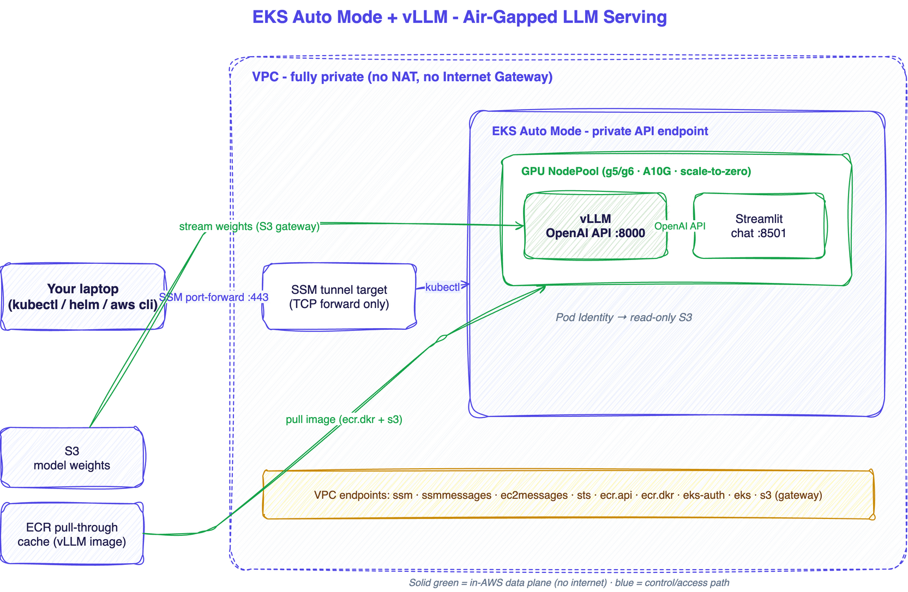
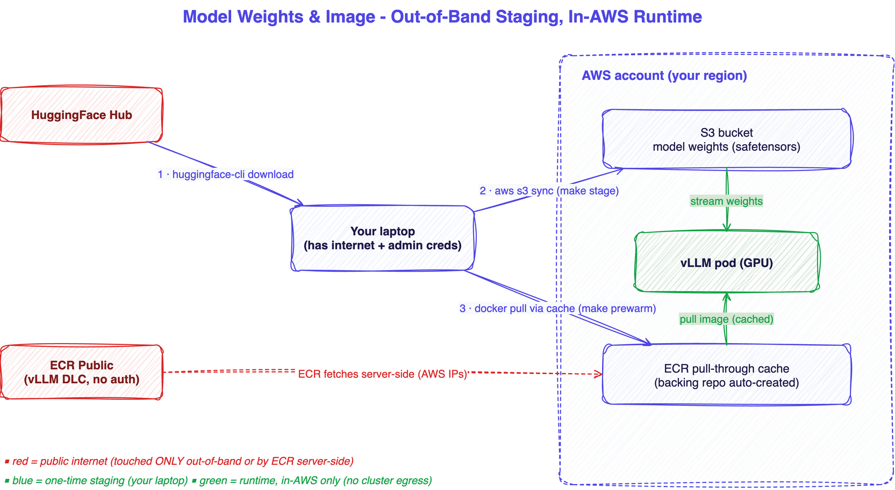

# EKS Auto Mode + vLLM - private LLM serving

Deploy an ~8B LLM on Amazon **EKS Auto Mode**, configured following best practices:

- Fully private API endpoint
- Air-gapped data plane (no NAT/IGW)
- EKS Pod Identity for least-privilege S3 access
- Weights streamed from S3 by vLLM (OpenAI-compatible API)
- A small Streamlit app to verify the deployment

The stack stands up from a clean account and tears down completely with one command, so it is cheap to run on demand. See [`DESIGN.md`](./DESIGN.md) for the architecture and the reasoning behind each decision.

> **New to model hosting?** If you know Kubernetes/EKS but terms like *model weights*, *safetensors*, *CUDA*, *inference server*, or *KV cache* are fuzzy, start with the [Model Hosting Primer](./docs/model-hosting-primer.md) - a brief, infra-oriented tour of the concepts this project uses.



## Components

- **EKS Auto Mode.** AWS manages Karpenter, NVIDIA GPU drivers + device plugin, EBS, load balancing, CoreDNS, and the Pod Identity Agent. None are installed by hand.
- **Air-gapped data plane.** No NAT, no Internet Gateway. The cluster reaches AWS only through VPC endpoints. The vLLM image comes via an ECR pull-through cache (no-auth ECR Public upstream, fetched server-side by ECR); model weights come from S3. Nothing in the cluster reaches the public internet.
- **Private API endpoint.** No public Kubernetes API. Access goes through a minimal SSM tunnel target: a small EC2 instance that only forwards TCP, with nothing installed and no cluster rights. kubectl runs on your laptop through the tunnel.
- **GPU NodePool.** Single A10G (`g5.xlarge`, falls back to `g6`), tainted so only the LLM schedules on it, scales to zero when idle. GPU vs AWS Neuron is the main accelerator decision; see [DESIGN.md](./DESIGN.md#accelerator-choice-nvidia-gpu-vs-aws-neuron) for why this uses GPU.
- **vLLM** streams weights from S3 into GPU memory (Run:ai streamer) over the S3 gateway endpoint: no init container, no local copy.
- **EKS Pod Identity** gives the serving pod read-only access to the one weights bucket.
- **Out-of-band weight staging.** Weights are downloaded from HuggingFace once, from your laptop, and pushed to S3. The cluster never contacts HuggingFace.

## Prerequisites

| Tool | Notes |
|---|---|
| OpenTofu **or** Terraform | `brew install opentofu` (or use existing `terraform`). Makefile auto-detects. |
| AWS CLI | authenticated to the **target account** (`aws sso login` / your method) |
| `session-manager-plugin` | for the SSM tunnel |
| `kubectl` | runs on your laptop, through the tunnel |
| `docker` | to build the Streamlit image |
| GPU quota | "Running On-Demand G and VT instances" ≥ 4 vCPUs in `ca-central-1` |

> GPU quota is the most common blocker. Fresh accounts often have it at 0. `make preflight` checks it and prints the increase request; approval can take ~24h.

## Quick start

Full lifecycle, from empty account to a working chat and back to a clean account:


```bash
make preflight          # creds, tooling, GPU quota
make up                 # provision infra (~15-20 min: VPC, EKS, endpoints, tunnel)
make stage              # download weights -> S3 (out-of-band; ~15GB, one-time)
make prewarm            # warm the ECR pull-through cache with the vLLM image
make image              # build + push the Streamlit image to ECR

# In terminal 1 - keep this running:
make tunnel

# In terminal 2:
export KUBECONFIG=$PWD/kubeconfig
make deploy             # apply GPU NodePool + vLLM + Streamlit
kubectl -n llm get pods -w   # wait for vllm to become Ready (GPU node ~2min + weight stream)

make verify             # open http://localhost:8501 and chat
```

Pause to save cost without tearing down (GPU node terminates, cluster stays; needs the tunnel up + `KUBECONFIG` set):

```bash
make scale-down         # vLLM + Streamlit -> 0 replicas; GPU node terminates a few min later
make scale-up           # back to 1; a fresh GPU node is provisioned (~2-4 min cold start)
```

`scale-up` needs no re-staging: weights stay in S3 and the image stays in the ECR cache. This drops cost from `~$1.25-1.50/hr` to `~$0.15-0.20/hr` (see [Cost](#cost-)). Use it for short pauses; use `make down` to remove everything.

When finished:

```bash
make down               # cluster cleanup, then tofu destroy
```

## How model weights and the image flow

The cluster has no internet egress, so both the model weights and the container image are staged **out-of-band** from your laptop, then served entirely from within AWS at runtime.



### Model weights

vLLM needs the model files (config, tokenizer, `*.safetensors` weight shards - ~15GB for an 8B model). This project stages them out-of-band and streams them from S3:

1. **Staging** (one-time, `make stage`, on your laptop). `hf download <model>` pulls the repo to a temp dir, then `aws s3 sync` uploads it to the weights bucket. This is the only step that touches HuggingFace, and it runs with your credentials from your machine, not from the cluster.
2. **Runtime** (in the pod). vLLM is started with `--model s3://<bucket>/<model>/ --load-format runai_streamer`. The Run:ai Model Streamer reads the safetensors **directly from S3 into GPU memory** over the **S3 gateway endpoint** - no NAT, no internet, no local disk copy. S3 auth is automatic via the `model-storage-sa` **Pod Identity** role (read-only on the one bucket).

Consequences:

- The data plane never touches the public internet.
- The slow ~15GB download is decoupled from cluster lifecycle.
- Pod restarts only re-stream from S3 (no re-download).
- The serving pod holds least-privilege S3 access.

> Safetensors only: the S3 streamer requires safetensors format. The default models ship safetensors. `stage-model.sh` excludes `*.pth`/`*.gguf`.

### The vLLM image

With no NAT/IGW, nodes can't pull from Docker Hub, so the image comes through an ECR pull-through cache:

- A pull-through rule points at ECR Public (`public.ecr.aws`), whose vLLM Deep Learning Container needs no credentials. The cluster pulls a URI like `…dkr.ecr.<region>.amazonaws.com/ecr-public/deep-learning-containers/vllm:<tag>`.
- On a cache miss, ECR fetches the upstream image server-side from AWS IPs; the node/VPC never touches the internet. Cached pulls come from your private registry over the `ecr.api`/`ecr.dkr` + S3 endpoints.
- `make prewarm` does the first pull once from your laptop (internet + admin creds). It creates the backing cache repo and populates the image, so cluster nodes need only `PullOnly` and never hit the first-pull edge cases.

> This is the AWS DLC build of vLLM, not the Docker Hub `vllm/vllm-openai` image; ECR Public needs no auth, which is what makes it work for an air-gapped cluster. It serves the same models. DLC tags are long and rotate; the pinned default is in `terraform/variables.tf` (`vllm_image_tag`). Verify a current tag in the [ECR Public Gallery](https://gallery.ecr.aws/deep-learning-containers/vllm) before deploy.

## Choosing / switching the model

Default is `Qwen/Qwen2.5-7B-Instruct`: open (Apache-2.0), no HuggingFace token needed, fits on a 24GB A10G in bf16.

To use a **gated** model like **Llama-3.1-8B-Instruct**:

1. Accept the license on its HuggingFace page and create an HF access token.
2. Stage with the token and model id:
   ```bash
   MODEL_ID=meta-llama/Llama-3.1-8B-Instruct HF_TOKEN=hf_xxx make stage
   ```
3. Set the same `model_id` for infra so the deploy templates the right S3 URI:
   ```hcl
   # terraform/terraform.tfvars
   model_id = "meta-llama/Llama-3.1-8B-Instruct"
   ```
   then `make up` (updates the Pod Identity/outputs) and `make deploy`.

Both models fit on one A10G with `--max-model-len 8192 --gpu-memory-utilization 0.90` (set in `k8s/vllm-deployment.yaml`). If you see a KV-cache OOM at startup, lower `--max-model-len` or `--gpu-memory-utilization`.

## Accessing the private cluster

The Kubernetes API is private - it only resolves and accepts connections from inside the VPC. `make tunnel`:

1. Resolves the cluster's real API hostname.
2. Opens `aws ssm start-session … AWS-StartPortForwardingSessionToRemoteHost` through the tunnel instance, forwarding `localhost:8443 → <api-host>:443`.
3. Writes `./kubeconfig` pointing at `https://localhost:8443` with `tls-server-name` set to the real hostname (so the API cert's SAN still verifies - it doesn't cover `localhost`).

Then `export KUBECONFIG=$PWD/kubeconfig` and use kubectl normally. You authenticate as your own AWS identity (granted cluster-admin at creation), not as the tunnel instance.

> **Instance-less alternative:** AWS CloudShell can launch *into your VPC* for ad-hoc kubectl without managing an instance - handy for one-offs, but not scripted here.

## Cost

Rough, region-dependent, while running:

| Component | ~$/hr |
|---|---|
| `g5.xlarge` A10G (on-demand) | ~1.00 |
| EKS control plane | 0.10 |
| Auto Mode management (per EC2) | small % surcharge |
| ~8 interface VPC endpoints | ~0.01 each (~0.08) |
| SSM tunnel instance (`t3.small`) | ~0.02 |

**≈ $1.25-1.50/hr with the GPU running.** No NAT (removed), so idle-but-up cost is just endpoints + tunnel (a few cents/hr).

The GPU node is the bulk of the bill, so there are three cost states:

| State | ~$/hr | What's running |
|---|---|---|
| Running | ~1.25-1.50 | GPU node + control plane + tunnel + endpoints |
| **Scaled to zero** (`make scale-down`) | **~0.15-0.20** | control plane + tunnel + endpoints (no GPU) |
| Destroyed (`make down`) | ~0 | nothing |

`make scale-down` / `make scale-up` (see [Quick start](#quick-start)) pause the model without tearing down the cluster.

## Teardown safety

`make down`:

1. Deletes any `LoadBalancer`/`Ingress` objects (this stack uses only ClusterIP, so usually none) and the `llm` namespace + GPU NodePool, so Auto Mode releases the GPU node.
2. Deletes the **auto-created pull-through cache repo** (`ecr-public/…`) - it's created by ECR on first pull, not by Terraform, so `destroy` wouldn't catch it.
3. Runs `tofu/terraform destroy`. The S3 bucket (`force_destroy`) and Streamlit ECR repo (`force_delete`) are removed even if non-empty. Auto Mode self-cleans its own EC2/ENI/SG/LB via its service-linked role on cluster deletion.
4. Prints a command to sanity-check for stragglers.

## Repo layout

```
terraform/        # OpenTofu/Terraform - infra (VPC, EKS Auto Mode, endpoints, IAM, S3, ECR, tunnel)
k8s/              # workload manifests - GPU NodePool, namespace/SA, vLLM, Streamlit
src/streamlit/    # Streamlit chat app source (app.py, Dockerfile, requirements.txt)
scripts/          # preflight, stage-model, prewarm-image, build-streamlit, tunnel, deploy, verify, destroy
diagrams/         # hand-drawn .drawio sources  (make diagrams → docs/diagrams/*.png)
Makefile          # lifecycle targets (see `make help`)
DESIGN.md         # architecture + decisions
```

## Diagrams

The diagrams above are generated from `diagrams/*.drawio` (hand-drawn style) via the draw.io desktop CLI:

```bash
make diagrams           # exports diagrams/*.drawio → docs/diagrams/*.png
```

Edit a `.drawio` source in the draw.io desktop app, then re-run `make diagrams` to refresh the SVGs.

## Implementation notes

- Auto Mode auto-installs NVIDIA drivers + device plugin and the Pod Identity Agent; none are installed manually here.
- NodePool uses the Auto Mode API group `karpenter.sh/v1` and references the built-in `default` NodeClass (`eks.amazonaws.com`).
- vLLM `s3://` streaming via `--load-format runai_streamer` is AWS's documented pattern.
- ECR pull-through cache fetches unauthenticated upstreams **server-side from AWS IPs**, so cached pulls need no cluster internet egress; `make prewarm` populates the cache first to avoid any first-pull edge cases and keep node IAM at `PullOnly`.
- Two-phase apply: infra (AWS provider) applies from anywhere; **workloads apply through the tunnel** because the Kubernetes API isn't reachable from outside the VPC. This split also keeps `destroy` reliable.

### Pinned versions / verify-on-first-run

- AWS provider `~> 6.42`, `terraform-aws-modules/eks ~> 21.0`, `.../vpc ~> 5.13`, Kubernetes `1.33`.
- **Verify the vLLM DLC tag** (`vllm_image_tag` in `terraform/variables.tf`) against the [ECR Public Gallery](https://gallery.ecr.aws/deep-learning-containers/vllm) - these tags rotate. Also confirm the DLC entrypoint takes the same `vllm serve` args (it does as of writing) if you bump to a very different version.
- Confirm the A10G label value after first node launch: `kubectl get nodes --show-labels | grep instance-gpu-name` (expected `a10g` on g5).

## Troubleshooting

Both of these surfaced during the first deployment:

- Both passed `terraform validate`, `shellcheck`, and YAML parsing.
- Both failed only at pod runtime; static checks don't catch runtime config interactions.
- Inspect a crash with `kubectl -n llm logs <pod> --previous`.

### Don't name the Service `vllm` (or anything matching an env var the container reads)

**Symptom:** vLLM crashes at engine-core init with `ValueError: VLLM_PORT 'tcp://10.x.x.x:8000' appears to be a URI`.

**Cause:** Kubernetes injects legacy Docker-link env vars for every Service, named `{SERVICENAME}_PORT=tcp://<ip>:<port>` in uppercase. A Service named `vllm` produces `VLLM_PORT`, which vLLM also reads as its **own** config (an integer port) - so it chokes on the `tcp://` URI. This is a classic Kubernetes trap, not vLLM-specific: it bites any app whose config env-var prefix matches a Service name (`redis`, `postgres`, etc.).

**Fix (applied here):** the vLLM Service is named **`llm-api`**, not `vllm`. If you rename it, keep it clear of the `VLLM_` prefix and update `VLLM_BASE_URL` in `k8s/streamlit.yaml`.

### Don't set `HF_HUB_OFFLINE` when loading from `s3://`

**Symptom:** vLLM crashes immediately at arg parsing with `HFValidationError: Repo id must be in the form 'repo_name' or 'namespace/repo_name': 's3://...'`.

**Background.** The `--model` string can be one of three things, and vLLM resolves each differently:

- a HuggingFace repo id (`Qwen/Qwen2.5-7B-Instruct`),
- a local path (`/models/qwen`),
- an object-storage URI (`s3://bucket/qwen/`) - what this project uses.

`snapshot_download()` is a HuggingFace Hub function that assumes its input is a repo id; the first thing it does is validate the `name` / `namespace/name` format. An `s3://` string fails that check.

**Cause (vLLM 0.22.0, version-specific).** The crash is an ordering problem in startup:

- With `HF_HUB_OFFLINE=1`, `AsyncEngineArgs.__post_init__` takes an offline branch that calls `get_model_path(self.model)` -> `snapshot_download(repo_id=self.model)`. That branch has no `s3://` guard - it assumes the model string is a HF repo id, so it rejects the URI and crashes.
- This runs early, at engine-arg init. vLLM's actual S3 handler, `maybe_pull_model_tokenizer_for_runai()` (detects `s3://`, pulls via the Run:ai streamer, rewrites `self.model` to a local path), runs *later* in startup. The offline branch fails before the S3 handler ever sees the string.
- The flag bought nothing: the Run:ai streamer fetches model + tokenizer from S3 itself and needs no internet to stay offline. So `HF_HUB_OFFLINE` was both unnecessary and the thing breaking startup.

**Fix (applied here):** do **not** set `HF_HUB_OFFLINE` / `TRANSFORMERS_OFFLINE` on the vLLM pod (see the comment in `k8s/vllm-deployment.yaml`). Startup then skips the offline branch, reaches the S3 handler, and loads normally - still with zero internet egress, because the streamer never needed the flag.

**Caveats.** This is specific to vLLM 0.22.0; a later version may add an `s3://` guard to that branch and make the flag harmless, so re-test before adding it back. The function/line names are from inspecting the 0.22.0 source during debugging; the behavior (crash before the S3 handler, fixed by removing the flag) was verified on a live deploy.

### Harmless things you may notice

- `Unknown vLLM environment variable detected: VLLM_PORT_8000_TCP_*` warnings: the same Kubernetes service-discovery env vars; vLLM ignores them. Not an error.
- A second vLLM pod stuck `Pending` during a rollout: expected - the GPU NodePool caps at one GPU, so a 2nd replica can't schedule until the old one frees the node. Resolves itself.
