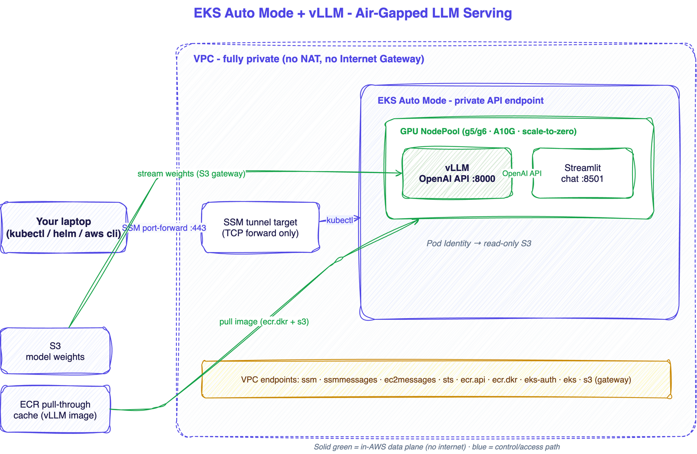
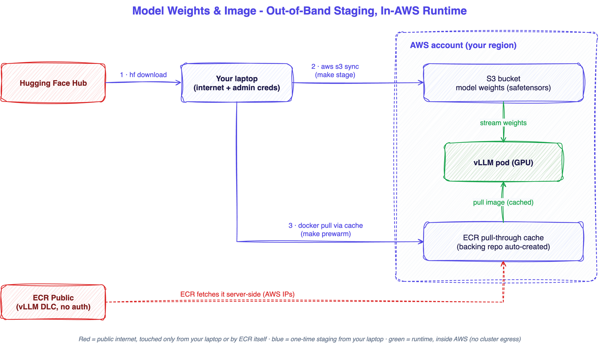

# Serving an LLM on EKS Auto Mode

## A private model, in a cluster that can't reach the internet

Omkar Patil

---

## What we wanted

Run a useful open model on EKS the way you would for sensitive data, and keep it cheap enough to throw away after each session.

- **Private:** no public Kubernetes API, no internet from the cluster, the smallest IAM permissions that work.
- **Cheap:** one GPU, one replica, scale to zero, and one command to remove everything.
- **Small:** EKS Auto Mode runs the nodes, GPU drivers and add-ons, so we only write what's specific to the model.

What it is not: a production service, or custom serving code. vLLM does the serving; we configure it.

---

## What runs

- **Qwen2.5-7B-Instruct.** Open license, no Hugging Face token, swappable for Llama.
- **vLLM,** serving an OpenAI-compatible API.
- **One NVIDIA A10G** (24 GB) on a `g5` instance, with `g6` as a fallback.
- **A small Streamlit chat app,** to prove it works end to end.

A model is just a directory of files: weights, config and tokenizer. vLLM loads them into GPU memory. Everything around it is ordinary Deployments, Services and IAM.

---

## Architecture



---

## The catch: no internet

The VPC has no NAT gateway and no internet gateway. The cluster reaches AWS only through VPC endpoints.

That creates three problems, and every piece of this design answers one:

1. **Getting the model in.** 15 GB of weights, and no route to Hugging Face.
2. **Getting the image in.** No route to Docker Hub either.
3. **Getting yourself in.** The Kubernetes API is private, so `kubectl` on a laptop has nothing to reach.

---

## Problem 1: getting the model in



---

## Download once, stream from S3

- **Once, on your laptop:** `make stage` downloads the weights and copies them to an S3 bucket. This is the only step that talks to Hugging Face.
- **Every pod start:** vLLM runs with `--model s3://<bucket>/<model>/ --load-format runai_streamer`. The Run:ai streamer reads the files from S3 over many connections, straight into GPU memory.
- **No keys:** the pod's service account gets a read-only role for that one bucket through Pod Identity.

So the bytes never leave AWS, nothing is copied to disk, and a restart streams again instead of downloading again. Recreating the whole cluster doesn't download the model either.

---

## Problem 2: getting the image in

- AWS publishes its own vLLM image on **ECR Public**, which needs no login.
- An **ECR pull-through cache** points at it. On a miss, ECR fetches the image from its own side, not through our VPC.
- `make prewarm` does that first pull from a laptop, so the nodes only ever read from the cache and keep a pull-only role.

The image gets the same guarantee as the weights: the cluster never touches the internet to get it.

---

## Problem 3: getting yourself in

SSM can forward a port, but only through an instance running its agent. So there is one tiny EC2 instance with no SSH key, no public IP, nothing installed and no cluster permissions. It is a relay, not a bastion.

```bash
make tunnel                       # localhost:8443 -> private API :443
export KUBECONFIG=$PWD/kubeconfig
kubectl get nodes                 # runs on your laptop, as your own AWS identity
```

The API's certificate is issued for its real hostname, not `localhost`. The tunnel script sets `tls-server-name`, so `kubectl` connects locally but checks the certificate against the right name.

---

## Two layers, applied separately

- **Terraform** only talks to AWS: VPC, endpoints, EKS, IAM, S3, ECR, the tunnel instance. It runs from anywhere.
- **Kubernetes manifests** (GPU NodePool, vLLM, Streamlit) go through the tunnel, because that's the only way to reach the API.

Keeping Kubernetes out of Terraform also keeps `destroy` reliable. Terraform never needs to talk to a cluster it is in the middle of deleting.

---

<style scoped>pre { font-size: 12px; } section { font-size: 20px; }</style>

## A NodePool just for the GPU

Auto Mode's built-in pools don't launch GPU instances, so we add one. Auto Mode still supplies the NVIDIA driver and device plugin.

```yaml
apiVersion: karpenter.sh/v1
kind: NodePool
spec:
  template:
    spec:
      nodeClassRef: { group: eks.amazonaws.com, kind: NodeClass, name: default }
      taints: [{ key: nvidia.com/gpu, effect: NoSchedule }]   # only vLLM tolerates this
      requirements:
        - { key: eks.amazonaws.com/instance-family, operator: In, values: [g5, g6] }
        - { key: karpenter.sh/capacity-type, operator: In, values: [on-demand] }
  disruption: { consolidationPolicy: WhenEmpty, consolidateAfter: 1m }   # scale to zero
  limits: { nvidia.com/gpu: "1" }                                        # never a second GPU
```

- The **taint** keeps everything else off the expensive node.
- **`WhenEmpty`** removes the node a minute after the model's pod goes away.
- The **limit** stops a mistake from launching a second GPU.

---

<style scoped>pre { font-size: 12px; } section { font-size: 20px; }</style>

## The vLLM pod

```yaml
containers:
  - name: vllm
    image: <ECR pull-through cache>/deep-learning-containers/vllm:<tag>
    args: ["--model=s3://<bucket>/<model>/", "--load-format=runai_streamer",
           "--served-model-name=chat", "--port=8000",
           "--max-model-len=8192", "--gpu-memory-utilization=0.90"]
    resources:
      requests: { cpu: "4", memory: 24Gi, nvidia.com/gpu: 1 }
      limits:   { memory: 24Gi, nvidia.com/gpu: 1 }
    volumeMounts: [{ name: shm, mountPath: /dev/shm }]
    startupProbe: { httpGet: { path: /health, port: 8000 }, failureThreshold: 60 }
volumes:
  - name: shm
    emptyDir: { medium: Memory, sizeLimit: 8Gi }
```

- **`chat`** is a stable name for clients, whichever model is behind it.
- **Context length and memory fraction** are sized for the 24 GB A10G. The next slides show the math.
- **`/dev/shm`:** PyTorch shares memory between processes, and the container default is tiny.
- **The startup probe** allows up to 10 minutes for the weights to stream in.

---

## How an answer is generated

One **forward pass** sends input through all the model's layers (28 for Qwen). An answer takes many passes:

```text
prefill  [all prompt tokens] -> layers 1..28 -> token 1   one pass, fills the KV cache
decode   [token 1]           -> layers 1..28 -> token 2   one pass per token
decode   [token 2]           -> layers 1..28 -> token 3   ... until the answer ends
```

- **Prefill is parallel.** The whole prompt is known, so it goes through in one pass.
- **Decode is one token at a time.** Each step reads all ~15 GB of weights, so memory speed is the limit. Batching several conversations into one step shares that read.

That's why users feel two delays: **time to first token** (queue + prefill) and **time between tokens** (one decode step).

---

## Will it fit? The memory math

Each token's keys and values stay in the **KV cache**, per conversation:

```text
KV per token  = 2 x layers x KV heads x head size x 2 bytes
Qwen2.5-7B    = 2 x 28 x 4 x 128 x 2  = 56 KiB  -> 448 MiB per 8,192-token conversation
```

```text
A10G usable memory                 ~22.5 GiB
x 0.90 --gpu-memory-utilization    ~20.2 GiB
- weights (7.6B x 2 bytes)         ~14.2 GiB
- working memory and overhead       ~1.5 GiB
= KV cache                          ~4.5 GiB  ->  ~10 full-length conversations
```

Llama-3.1-8B needs 1 GiB per conversation, so the same GPU holds about 3. If vLLM refuses to start, lower `--max-model-len`. Lowering the memory fraction makes it worse.

---

## Why GPU and not AWS Neuron

Neuron (Inferentia, Trainium) is roughly 30-40% cheaper, but every model must be **compiled ahead of time** for it.

- **GPU:** hand vLLM the safetensors and it serves them. Any model works, the S3 streamer works, and the skills transfer anywhere.
- **Neuron:** only compiled models run, and our default model isn't on AWS's list. Its loader can't stream from S3, so we'd need an init container. Staying offline means staging the compiled artifacts too.

Neuron's saving pays off over months of steady production traffic. This cluster lives for an afternoon, so the GPU wins.

---

## Two things that broke

Both passed `terraform validate`, `shellcheck` and YAML checks. Both failed only once the pod ran.

- **A Service named `vllm`.** Kubernetes injects `VLLM_PORT=tcp://10.x.x.x:8000` into every pod. vLLM reads `VLLM_PORT` as its own setting, expects a number, and crashes. The Service is now `llm-api`. Any app whose settings share a prefix with a Service name can hit this.
- **`HF_HUB_OFFLINE=1`.** It sounds right for an offline cluster. But in vLLM 0.22.0 it pushes the model name through a Hugging Face check that rejects `s3://` before the S3 loader ever runs. The streamer never needed the internet, so the flag is simply left out.

---

## Running it

```bash
make preflight   # credentials, tools, GPU quota (new accounts often have 0)
make up          # infrastructure, ~15-20 min
make stage       # weights to S3, once
make prewarm     # vLLM image into the ECR cache, once
make image       # Streamlit image
make tunnel      # in its own terminal
make deploy      # NodePool, vLLM, Streamlit
make verify      # chat at localhost:8501
```

- **Running:** about $1.45-1.60 an hour, most of it the GPU.
- **`make scale-down`:** about $0.30-0.35 an hour, mostly the control plane and the VPC endpoints. `scale-up` is back in 2-4 minutes.
- **`make down`:** removes everything, including the ECR cache repository Terraform doesn't know about.

---

## What we took away

- **An offline cluster is mostly a staging problem.** Decide how the model, the image and the operator get in, and the rest follows.
- **Auto Mode removes most of the platform work.** What's left is the model-specific part: a GPU NodePool, a Deployment and IAM.
- **Do the memory math before you deploy.** Weights plus KV cache decide the model, the context length and how many users one GPU can serve.
- **Static checks don't catch runtime surprises.** Both failures only showed up once the pod ran.
