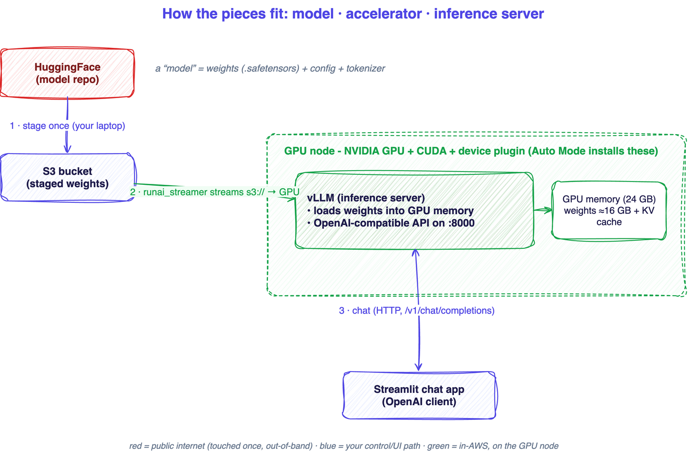

# Model Hosting Primer (for the k8s-fluent, ML-curious)

A brief tour of the LLM-serving concepts this project uses, written for someone who knows Kubernetes/EKS well but is new to model hosting. Every term is tied back to what this repo actually does. For the architecture and decisions, see [DESIGN.md](../DESIGN.md); for the runbook, see [README.md](../README.md).

## What *is* "a model"?

When we say "deploy a model," we mean shipping a directory of files - not a binary, not a service. A typical LLM repo (e.g. on HuggingFace) contains three kinds of things:

1. **Weights** - the actual learned numbers. These are huge matrices of floating-point values produced by training. For an "8B" model that's ~8 billion numbers. This is the bulk of the size (~15 GB for 8B) and what we stage to S3.
2. **Config** - small JSON describing the model's *shape* (layer count, dimensions, vocab size) so the serving software knows how to wire the weights together.
3. **Tokenizer** - the rules for turning text into the integer **tokens** the model consumes, and back again.

> **Mental model:** weights are like a container image layer (big, immutable data), config is like the manifest describing how to run it, and the tokenizer is the codec at the edges. "Loading a model" = reading these files into accelerator memory and standing up something that can answer requests.

### "Weights" and the `.safetensors` format

The weights ship as files. The modern, safe format is **`.safetensors`** (a flat, memory-mappable tensor format - no arbitrary code execution, unlike the older Python `pickle`/`.bin`/`.pth` format). This matters to us concretely: the S3-streaming loader we use (`runai_streamer`) **requires safetensors**, which is why `scripts/stage-model.sh` excludes `*.pth`/`*.gguf`.

### Loading weights from S3: the Run:ai Model Streamer

`runai_streamer` is the **third-party, open-source Run:ai Model Streamer** (from Run:ai, acquired by NVIDIA in 2024 - *not* an AWS tool). It isn't a separate process you run; it's a **loading backend built into vLLM**, selected with `--load-format runai_streamer` (shipped in the AWS vLLM image we use).

The naive way to load from object storage is two sequential steps: download all ~15 GB to local disk, *then* read it into GPU memory. The streamer **collapses these into one concurrent operation** - it reads the safetensors tensors over many parallel connections and feeds them **straight into GPU memory as they arrive**, with no full local copy and no download-then-load wait. The payoff is faster cold starts and no scratch disk.

Why it fits this project:

- **Speaks `s3://` natively** - `--model s3://bucket/path/` streams directly. This is the basis of our "weights live in S3, no local copy" approach.
- **Uses the AWS SDK's default credential chain** - so our **Pod Identity** role (read-only S3) is picked up automatically; no keys are passed to vLLM.
- Combined with the **S3 gateway VPC endpoint**, bytes travel S3 → GPU **entirely inside AWS** (no NAT, no internet) - what makes the air-gapped data plane possible.
- **Safetensors only** - it memory-maps tensors directly, so it can't read `.pth`/`.gguf`. (It's also GPU-path-specific, which is one reason the Neuron alternative uses a different loader entirely.)

### "7B / 8B" - parameters, and why they dictate hardware

The "B" is **billions of parameters** (individual weights). It's the single most important number for hardware sizing, because every parameter is a number that has to be physically stored in the accelerator's memory:

- **Memory = parameters × bytes-per-number.** Each weight is a decimal number, and how many **bits** you use to store one number is a choice. The common choice for serving is **16-bit** (2 bytes per number) - so an 8B model needs roughly 8 billion × 2 bytes ≈ **16 GB** just for weights. That has to fit in the accelerator's memory: an A10G GPU has **24 GB**, so 8B fits with headroom; a 70B model (~140 GB) would not fit on one.
- **Precision - how many bits per number** (vLLM's `--dtype` flag). More bits = more exact numbers but more memory; fewer bits = smaller but coarser.
  - **32-bit** (`fp32`, "full precision") is what models are originally trained in - most exact, but 4 bytes/number.
  - **16-bit** (`fp16` or `bf16`, "**half** precision") halves that to 2 bytes/number with negligible quality loss for inference. This is the standard default, and what we use.
  - **`fp16` vs `bf16`** are two ways to lay out those 16 bits; `bf16` ("brain float") trades a bit of fractional accuracy for a wider numeric range that's more training-stable. Both are 2 bytes - for our purposes they're interchangeable, and modern GPUs/models prefer `bf16`.
- **Quantization** goes further - squeezing each number into **8 or even 4 bits** (1 byte or ½ byte) to shrink the model so it fits on smaller/cheaper hardware. The trade-off is some loss of answer quality, since you're storing each weight more coarsely. **We don't quantize**, because an 8B model in 16-bit already fits comfortably on the 24 GB A10G - quantization is a tool for when a model is *too big* for your accelerator.

This is why the whole project revolves around a single GPU instance and an ~8B model: it's the sweet spot where one affordable accelerator serves a genuinely useful model at full 16-bit quality.

## The accelerator: GPUs and CUDA

An **accelerator** is the chip that does the massively-parallel math (GPUs were built for graphics; the same parallelism suits ML). 

**CUDA** is NVIDIA's proprietary software platform - the drivers, libraries, and programming API - for running general computation on NVIDIA GPUs. Because NVIDIA got there first and everyone built on it, **CUDA is the de-facto standard**: virtually every ML framework and model targets CUDA first. In practice that means you can hand an NVIDIA GPU a standard model and it runs, because the whole ecosystem assumes CUDA.

In EKS terms: the GPU needs a kernel driver + a Kubernetes **device plugin** (so pods can request `nvidia.com/gpu: 1` the way they request CPU/memory). **EKS Auto Mode installs both for us** - that's a big reason we chose it.

### The Neuron contrast (and "NEFF graphs")

AWS **Neuron** (Trainium/Inferentia chips) is the cheaper, AWS-built alternative - but it is *not* CUDA-compatible. A model can't run on Neuron as-is; it must first be **compiled** by Neuron's compiler into its own format. The compiled output is a set of **NEFF** files (Neuron Executable File Format) - precompiled compute graphs, analogous to building a binary for a specific CPU architecture instead of running an interpreted script.

That compile-ahead step is the whole trade-off: Neuron is cheaper to run but you can only serve models someone has compiled (or that you compile yourself). We chose GPU to avoid it. Full comparison in [DESIGN.md](../DESIGN.md#accelerator-choice-nvidia-gpu-vs-aws-neuron).

## The inference server: what vLLM actually does

The model files are inert data. The **inference server** is the long-running process that loads them into accelerator memory and turns HTTP requests into generated text. We use **vLLM** - a high-throughput LLM serving engine. Its jobs:

- Load the weights onto the GPU and keep them resident.
- Accept requests, run the model's math to generate output tokens one at a time, and stream the results back.
- Batch many concurrent requests efficiently (its headline feature).

In k8s terms: vLLM is just the container in our `Deployment`. The "model" is data it reads at startup (from S3, in our case); the Service in front is an ordinary `ClusterIP`.

### "OpenAI-compatible API"

vLLM exposes the **same HTTP API shape as OpenAI's** (`POST /v1/chat/completions`, `GET /v1/models`, etc.). This is a de-facto standard: any client or library written for OpenAI works against vLLM by changing the base URL. The Streamlit app uses the stock `openai` Python client pointed at `http://llm-api:8000/v1`, with no custom protocol.

### Tokens and context length

- **Token** - a chunk of text, about ¾ of a word. Models read and write tokens, not characters.
- **Context length** (`--max-model-len`) - the most tokens one conversation can hold, prompt and answer together. Qwen2.5-7B supports 32,768; we cap it at 8,192 to save memory.

### How an answer is generated: prefill and decode

The model is a stack of layers (28 for Qwen2.5-7B). One **forward pass** sends input through every layer in order, each layer's output feeding the next. Generating an answer takes many passes, in two phases:

```text
Prompt: "Explain a Kubernetes pod in one sentence."   (~10 tokens)

prefill  [all 10 prompt tokens] -> layers 1..28 -> token 1    one pass, fills the KV cache
decode   [token 1]              -> layers 1..28 -> token 2    one pass per token
decode   [token 2]              -> layers 1..28 -> token 3
         ...                                                  until the answer ends
```

- **Prefill is parallel.** The whole prompt is known up front, so all its tokens go through the layers together in one pass. A longer prompt makes that pass heavier, not more numerous.
- **Decode is sequential.** Token 3 can't be computed until token 2 exists, so every output token costs a full pass.
- **Each decode step reads all ~15 GB of weights to produce one token per conversation.** Memory speed, not arithmetic, is usually the limit. Running several conversations in the same step shares that read, which is why vLLM batches requests and why its throughput beats a naive server.

This is why a model request is unlike a normal web request. The answer is produced over many steps, its cost grows with the length of the answer, and the connection stays open while tokens stream back. It also explains the two delays a user notices: **time to first token** (waiting in the queue plus prefill, longer for long prompts) and **time between tokens** (one decode step).

### The KV cache

Inside each layer, every token produces a **key** and a **value**: vectors that later tokens look back at to decide what matters. Without a cache, each decode step would recompute them for every earlier token. The **KV cache** keeps them in GPU memory instead, so prefill fills it with the prompt and each decode step adds one more token's worth.

That memory is the second big consumer after the weights, and it is per conversation. The size per token comes straight from the model's `config.json`:

```text
KV bytes per token = 2 (key + value) x layers x KV heads x head size x bytes per number
```

For Qwen2.5-7B (28 layers, 4 KV heads, head size 128, 16-bit):

```text
2 x 28 x 4 x 128 x 2 bytes = 57,344 bytes = 56 KiB per token
One full 8,192-token conversation = 8,192 x 56 KiB = 448 MiB
```

### Doing the memory math for this project

Put the pieces together for the A10G:

```text
GPU memory the A10G reports           ~22.5 GiB
x 0.90 (--gpu-memory-utilization)     ~20.2 GiB   vLLM's budget
- weights (7.6B params x 2 bytes)     ~14.2 GiB
- working memory and overhead         ~1.5 GiB    rough; depends on vLLM version
= left for the KV cache               ~4.5 GiB
/ 448 MiB per full conversation       ~10 conversations at the full 8,192 tokens
```

Most conversations are much shorter than 8,192 tokens, and vLLM only allocates cache for tokens that exist, so in practice it serves more than ten at once. You don't have to trust the estimate: at startup vLLM logs the KV cache size in tokens and the maximum concurrency for `--max-model-len`-sized requests.

Llama-3.1-8B shows how quickly this changes. It has 32 layers and 8 KV heads, so its cache costs 128 KiB per token: 1 GiB per full conversation. Its weights are also bigger (8B params, ~15 GiB). The same GPU then holds only about three full-length conversations.

**When vLLM refuses to start.** vLLM checks at startup that at least one conversation of `--max-model-len` tokens fits in the cache. If it doesn't, it exits with an error about the KV cache. The fixes, in order:

- **Lower `--max-model-len`.** Halving it halves the cache needed per conversation.
- **Raise `--gpu-memory-utilization`** a little, if nothing else uses the GPU. Lowering it shrinks the cache budget and makes this error worse.
- **Use a smaller or quantized model,** or a bigger GPU.

## How it all fits in this project



- **A "model"** = the safetensors weights + config + tokenizer we stage into **S3**.
- **The accelerator** = an NVIDIA **GPU** (A10G), with CUDA + device plugin handled by **Auto Mode**.
- **The inference server** = **vLLM**, serving an **OpenAI-compatible API**, which **Streamlit** chats with.

With the k8s side already familiar to you, the only new layer here is "a model is a directory of weights that must fit in accelerator memory, loaded by a serving process." Everything else is ordinary Deployments, Services, and IAM.
